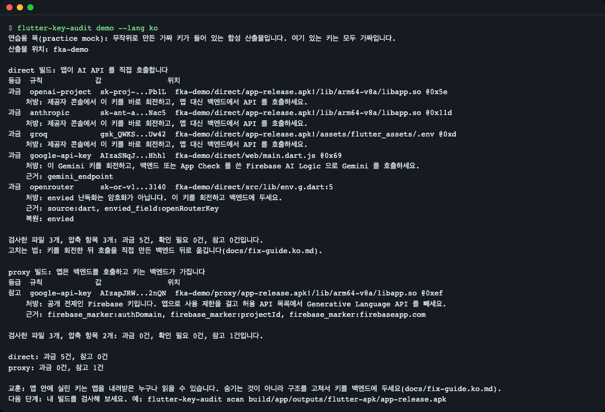
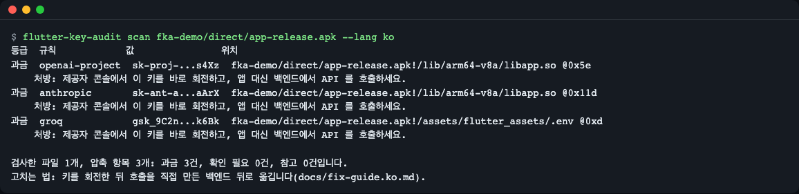
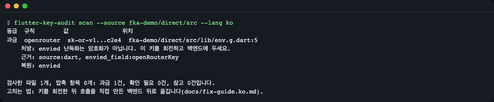
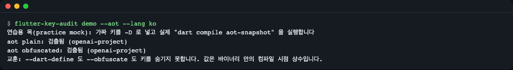
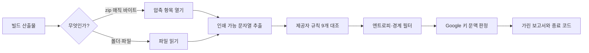

# flutter-key-audit

[English](README.md) | **한국어**

Flutter 빌드가 사용자에게 그대로 실어 보내는 과금형 AI API 키(OpenAI, Anthropic, Gemini, Groq 등)를 찾아내고, 호출을 백엔드 뒤로 옮기는 방법까지 알려 주는 도구입니다. APK, AAB, IPA, macOS 앱, 웹 빌드, 소스를 오프라인으로 검사하며 키를 전체로 출력하지 않습니다.


*`flutter-key-audit demo`: 같은 앱을 두 방식으로 빌드한 결과. 직접 호출 빌드는 키 5개가 노출되고, 백엔드 경유 빌드는 0개입니다(무작위 가짜 키를 쓰는 연습용 목).*

## 이런 분께

- Flutter 앱에서 OpenAI, Anthropic, Gemini 를 직접 호출하고, 올리기 전에 릴리스 빌드 안에 무엇이 들었는지 확인하고 싶은 분
- `app-release.apk`, `build/web`, `.ipa` 에서 과금 키가 나오면 CI 빌드를 실패시키고 싶은 분
- `--dart-define`, `--obfuscate`, envied 로 키가 숨겨졌다고 믿고 있는 분. 숨겨지지 않습니다([동작 원리](#동작-원리) 참고).

## 설치

[Dart SDK](https://dart.dev/get-dart) 3.8 이상이 필요합니다(Flutter 에 들어 있습니다). 최소 리눅스 이미지에서는 `git` 과 `curl` 도 필요합니다.

### pub.dev 에서

```bash
dart pub global activate flutter_key_audit
flutter-key-audit --version
```

```text
flutter-key-audit 0.1.2
```

실행 파일은 pub 캐시의 `bin` 폴더(macOS·Linux 는 `$HOME/.pub-cache/bin`, Windows 는 `%LOCALAPPDATA%\Pub\Cache\bin`)에 생기므로 이 폴더가 `PATH` 에 있어야 합니다. activate 로 설치한 도구는 JIT 스냅샷으로 실행되어 컴파일한 실행 파일보다 시작이 조금 느립니다. [dart pub global](https://dart.dev/tools/dart-pub#global-activate) 참고.

### 소스에서 빌드

```bash
git clone https://github.com/LeeGyeongPil/flutter-key-audit
cd flutter-key-audit
dart pub get
mkdir -p build
dart compile exe bin/flutter_key_audit.dart -o build/flutter-key-audit
build/flutter-key-audit --version
```

`build/flutter-key-audit` 를 `PATH` 에 두거나 경로로 부르세요. 아래 예시는 줄여서 `flutter-key-audit` 로 씁니다.

## 빠르게 시작하기

먼저 연습용 목(mock)을 돌려 보세요. 키도 네트워크도 Flutter 빌드도 필요 없습니다. 실제 빌드와 같은 배치의 가짜 산출물을 무작위 가짜 키로 만들어 검사합니다.

```bash
flutter-key-audit demo --lang ko --out fka-demo
```

출력의 마지막 부분입니다.

```text
direct: 과금 5건, 참고 0건
proxy: 과금 0건, 참고 1건

교훈: 앱 안에 실린 키는 앱을 내려받은 누구나 읽을 수 있습니다. 숨기는 것이 아니라 구조를 고쳐서 키를 백엔드에 두세요(docs/fix-guide.ko.md).
다음 단계: 내 빌드를 검사해 보세요. 예: flutter-key-audit scan build/app/outputs/flutter-apk/app-release.apk
```

이것은 **연습용 목**입니다. 파일은 합성한 것이고, 예외로 `demo --aot` 는 실제로 Dart 프로그램을 컴파일합니다. 키 값은 실행할 때마다 무작위라서 스크린샷과 다르게 보입니다. 아래처럼 내 빌드를 검사하는 것이 실제 모드이고, 이것도 네트워크가 필요 없습니다.

내 릴리스 빌드를 검사합니다.

```bash
flutter build apk --release
flutter-key-audit scan build/app/outputs/flutter-apk/app-release.apk --lang ko
```

## 사용법

| 명령·옵션 | 하는 일 | 예 |
|---|---|---|
| `scan <경로>...` | APK, AAB, IPA, zip(확장자가 아니라 매직 바이트로 판별), 빌드 폴더, 파일을 검사 | `scan build/web` |
| `scan --source <폴더>` | 소스 모드: 텍스트 파일을 읽고 envied 키를 복원하며 줄 번호를 보고 | `scan --source .` |
| `-f, --format table\|json\|sarif` | 보고서 형식 | `--format sarif` |
| `-o, --output <파일>` | 보고서를 파일로 저장 | `--output fka.sarif` |
| `--fail-on billing\|review\|info\|none` | 종료 코드 1 이 되는 가장 낮은 등급(기본 `billing`) | `--fail-on review` |
| `--min-entropy <n>` | 이 샤넌 엔트로피 미만 후보를 버림(기본 3.0) | `--min-entropy 0` |
| `--max-entry-mb <n>` | 이 크기(MB)보다 큰 파일·압축 항목은 건너뜀(기본 512) | `--max-entry-mb 100` |
| `--exclude <글자>` | 이 글자가 든 경로를 건너뜀(반복 가능) | `--exclude test/` |
| `rules` | 검출 규칙 9개 목록 | `rules --lang ko` |
| `demo [--aot] [--out 폴더]` | 연습용 목. `--aot` 는 실제 Dart AOT 스냅샷도 컴파일 | `demo --aot` |
| `--lang en\|ko` | 출력 언어 | `--lang ko` |

빌드 종류별로 열어 보는 곳입니다.

| 빌드 | 도구가 여는 곳 |
|---|---|
| `flutter build apk` / `appbundle` | `lib/<abi>/libapp.so`, `assets/flutter_assets/`(`.env` 포함) |
| `flutter build ipa` | `Frameworks/App.framework/App`, `flutter_assets/` |
| `flutter build macos` | `.app` 폴더: `App.framework/App`, `flutter_assets/` |
| `flutter build web` | `build/web` 의 `main.dart.js` 와 자산 |
| 소스 | `.env`, Dart 파일, envied 생성 파일(`--source`) |

테스트 샌드박스에서는 실제 `flutter build apk`·`macos` 산출물을 만들지 못했습니다. 테스트는 같은 배치로 생성한 압축 파일을 쓰고, `demo --aot` 는 실제 Dart AOT 스냅샷(`libapp.so` 와 같은 형식)을 컴파일해 검사합니다.

### 1. APK 검사

```bash
flutter-key-audit scan fka-demo/direct/app-release.apk --lang ko
```


*각 행: 등급, 규칙, 가린 값, `압축파일!/항목 @0x오프셋`. 행의 둘째 줄은 해야 할 일입니다.*

```text
등급  규칙            값               위치
과금  openai-project  sk-proj-...X_LN  fka-demo/direct/app-release.apk!/lib/arm64-v8a/libapp.so @0x5e
    처방: 제공자 콘솔에서 이 키를 바로 회전하고, 앱 대신 백엔드에서 API 를 호출하세요.
과금  anthropic       sk-ant-a...EIPP  fka-demo/direct/app-release.apk!/lib/arm64-v8a/libapp.so @0x11d
    처방: 제공자 콘솔에서 이 키를 바로 회전하고, 앱 대신 백엔드에서 API 를 호출하세요.
과금  groq            gsk_HcRH...d0sr  fka-demo/direct/app-release.apk!/assets/flutter_assets/.env @0xd
    처방: 제공자 콘솔에서 이 키를 바로 회전하고, 앱 대신 백엔드에서 API 를 호출하세요.

검사한 파일 1개, 압축 항목 3개: 과금 3건, 확인 필요 0건, 참고 0건입니다.
고치는 법: 키를 회전한 뒤 호출을 직접 만든 백엔드 뒤로 옮깁니다(docs/fix-guide.ko.md).
```

과금 키가 나왔으므로 종료 코드는 1입니다. 값은 앞 8자 + `...` + 뒤 4자로만 보입니다. 키를 전체로 출력하는 옵션은 없습니다.

### 2. "고친" 빌드 확인

```bash
flutter-key-audit scan fka-demo/proxy/app-release.apk --lang ko
```

```text
등급  규칙            값               위치
참고  google-api-key  AIza70g9...mpnu  fka-demo/proxy/app-release.apk!/lib/arm64-v8a/libapp.so @0xef
    처방: 공개 전제인 Firebase 키입니다. 앱으로 사용 제한을 걸고 허용 API 목록에서 Generative Language API 를 빼세요.
    근거: firebase_marker:authDomain, firebase_marker:projectId, firebase_marker:firebaseapp.com

검사한 파일 1개, 압축 항목 2개: 과금 0건, 확인 필요 0건, 참고 1건입니다.
```

종료 코드 0입니다. Google `AIza...` 키는 모호합니다. Firebase 키는 공개를 전제로 하지만 Gemini 키는 아닙니다. 도구는 같은 파일·항목 안의 단서로 판정합니다.

| 등급 | 뜻 |
|---|---|
| `과금`(billing) | 과금될 수 있는 키: 제공자 규칙에 맞거나, `generativelanguage.googleapis.com` 주소 옆의 `AIza` 키 |
| `확인 필요`(review) | 단서 없는 `AIza` 키. Google Cloud 에서 제한 설정을 확인하세요 |
| `참고`(info) | Firebase 표지 옆의 `AIza` 키. 공개 전제이지만 사용 제한은 거세요 |

`근거:` 줄이 판정 증거를 보여 줍니다. 휴리스틱이므로 믿기 전에 읽어 보세요.

### 3. 소스 모드와 envied

```bash
flutter-key-audit scan --source fka-demo/direct/src --lang ko
```


*envied 난독화는 암호화가 아닙니다. 도구가 두 배열로 키를 복원해 줄 번호와 함께 보고합니다.*

```text
등급  규칙        값               위치
과금  openrouter  sk-or-v1...eb6b  fka-demo/direct/src/lib/env.g.dart:5
    처방: envied 난독화는 암호화가 아닙니다. 이 키를 회전하고 백엔드에 두세요.
    근거: source:dart, envied_field:openRouterKey
    복원: envied

검사한 파일 1개, 압축 항목 0개: 과금 1건, 확인 필요 0건, 참고 0건입니다.
고치는 법: 키를 회전한 뒤 호출을 직접 만든 백엔드 뒤로 옮깁니다(docs/fix-guide.ko.md).
```

소스 모드는 기본으로 `build/`, `.dart_tool/`, `.git/`, `ios/Pods/`, `node_modules/` 를 건너뜁니다. 소스 모드도 APK 검사와 같은 `고치는 법:` 줄을 출력합니다.

### 4. `--obfuscate` 는 키를 숨기지 못합니다

```bash
flutter-key-audit demo --aot --lang ko --out fka-aot
```


*`-D` 에 가짜 키를 넣고 실제 `dart compile aot-snapshot` 을 실행한 결과: 두 빌드 모두에서 검출됩니다.*

```text
연습용 목(practice mock): 가짜 키를 -D 로 넣고 실제 "dart compile aot-snapshot" 을 실행합니다
aot plain: 검출됨 (openai-project)
aot obfuscated: 검출됨 (openai-project)
교훈: --dart-define 도 --obfuscate 도 키를 숨기지 못합니다. 값은 바이너리 안의 컴파일 시점 상수입니다.
```

`--aot` 는 `PATH` 에 `dart` 가 있어야 합니다. 없으면 현지화된 오류를 출력하고 종료 코드 3으로 끝납니다.

### 5. 보고서와 종료 코드

```bash
flutter-key-audit scan fka-demo/direct/app-release.apk --format sarif --output fka.sarif --fail-on none --lang ko
```

JSON(`--format json`)은 `schema`, `tool`, `findings[]`(`rule`, `severity`, `confidence`, `redacted`, `location`, `context`, `fix`, `recovered`), `summary` 로 이루어집니다. SARIF 는 2.1.0 입니다. **JSON·SARIF·규칙 ID·근거(context) 코드는 `--lang` 과 상관없이 항상 영어 그대로입니다.**

| 종료 코드 | 뜻 |
|---|---|
| 0 | `--fail-on` 기준 이상인 항목 없음 |
| 1 | 기준 이상인 항목 발견 |
| 2 | 사용법 오류 |
| 3 | 입력·실행 오류(예: 경로 없음) |

### 6. CI

```yaml
- uses: dart-lang/setup-dart@v1   # Flutter 액션이 이미 Dart 를 제공하면 생략 가능
- run: dart pub global activate flutter_key_audit
- run: echo "$HOME/.pub-cache/bin" >> $GITHUB_PATH
- run: flutter build web --release
- run: flutter-key-audit scan build/web --format sarif --output fka.sarif --fail-on billing
- uses: github/codeql-action/upload-sarif@v4
  if: always()
  with:
    sarif_file: fka.sarif
```

## 고치기

키를 찾는 것은 절반입니다. 아래는 [docs/fix-guide.ko.md](docs/fix-guide.ko.md) 의 요약입니다.

1. **먼저 키를 회전하세요.** 배포된 빌드에 들어 있던 키는 다음 릴리스에서 빼더라도 유출된 것으로 보아야 합니다. 새 키를 만들어 백엔드에만 두고, 옛 키를 지우고, 제공자의 사용량 페이지에서 모르는 호출이 없는지 확인하세요.
2. **호출을 백엔드 뒤로 옮기세요.** 앱은 사용자의 로그인 토큰을 내 서버로 보내고, 제공자 키는 서버만 가집니다.

   이전(키가 바이너리에 들어갑니다):

   ```dart
   const apiKey = String.fromEnvironment('OPENAI_API_KEY');
   final res = await http.post(
     Uri.parse('https://api.openai.com/v1/chat/completions'),
     headers: {'Authorization': 'Bearer $apiKey', 'Content-Type': 'application/json'},
     body: jsonEncode({'model': 'gpt-4o-mini', 'messages': messages}),
   );
   ```

   이후(앱에 제공자 키가 없고, 모델과 제한은 백엔드가 정합니다):

   ```dart
   final res = await http.post(
     Uri.parse('https://api.your-app.example/v1/chat'),
     headers: {
       'Authorization': 'Bearer ${await auth.currentUserIdToken()}',
       'Content-Type': 'application/json',
     },
     body: jsonEncode({'messages': messages}),
   );
   ```

   백엔드는 토큰을 확인하고 사용자별 호출 제한과 비용 상한을 적용한 뒤, 자기 환경 변수의 키로 요청을 전달합니다. `dart:io` 만 쓰는 최소 스케치가 가이드에 있습니다(스케치일 뿐 운영 코드가 아닙니다).
3. **Gemini 는 Firebase AI Logic 과 App Check 를 쓰세요.** 앱 안에 Gemini 키 없이 호출하고, App Check 가 정품 앱이 아닌 요청을 거절합니다. Gemini Developer API 키를 `firebase_options.dart` 에 넣지 마세요. [Firebase AI Logic 문서](https://firebase.google.com/docs/ai-logic/app-check)를 보세요(2026-11-13 확인).
4. **Firebase 키는 제한하세요.** `google-services.json` 이나 `GoogleService-Info.plist` 의 `AIza...` 키는 설계상 공개 값입니다(`참고` 결과). Android 패키지와 SHA-1 또는 iOS 번들 ID 로 제한하고, API 제한 목록에서 *Generative Language API* 를 빼서 Gemini 호출에 과금되지 않게 하세요.
5. **다시 검사하세요.** 새 빌드를 만들어 `flutter-key-audit scan` 을 돌립니다. 종료 코드 0 은 그 파일에서 과금 키가 나오지 않았다는 뜻입니다.


## 설정

- **언어**: `--lang en|ko`, 다음 `FLUTTER_KEY_AUDIT_LANG`, `LC_ALL`, `LC_MESSAGES`, `LANG` 순서(`ko` 로 시작하면 한국어, 그 밖에는 영어).
- **규칙**: `flutter-key-audit rules` 가 규칙 9개를 보여 줍니다: `anthropic`, `openai-project`, `openai-legacy`, `openrouter`, `groq`, `huggingface`, `replicate`, `xai`, `google-api-key`. 키 형식은 2026-11-13 기준 제공자의 현재 형식이며 바뀔 수 있습니다.
- **심볼릭 링크**: 폴더를 훑다가 만난 파일 링크는 한 번만 검사합니다. 폴더를 가리키거나 대상이 없는 링크는 건너뛰고 요약에 셉니다(JSON 의 `links_skipped`). 실제 경로를 직접 넘기면 검사합니다.
- **낮은 엔트로피**: 글자당 3.0비트 미만 후보(예: `xxxxxxxx`)는 버리고 요약에 `low_entropy_skipped` 로 셉니다. 남기려면 `--min-entropy 0` 을 쓰세요.
- API 키·계정·네트워크가 필요 없습니다.

## 동작 원리



1. zip 은 첫 바이트(`PK\x03\x04`)로 열기 때문에 `.bin` 으로 이름을 바꾼 APK 도 열립니다.
2. 바이너리는 해석하지 않습니다. `strings -n 8` 처럼 인쇄 가능한 바이트가 8개 이상 이어진 구간만 뽑습니다. Dart 문자열 상수는 AOT 스냅샷에 평문으로 들어 있어 이것으로 충분합니다.
3. 각 구간을 제공자 규칙과 대조합니다. 키는 경계에서 시작해야 하고, 소스 모드에서는 끝도 경계여야 합니다.
4. 엔트로피가 낮은 후보는 버리므로 `xxxx` 같은 가짜 키는 세지 않습니다.
5. `AIza` 키는 같은 파일·항목 안의 다른 단서로 등급을 가릅니다.
6. 결과는 키 가운데를 가려 출력합니다. 원문은 메모리 안에서 비교에만 쓰고 어디에도 쓰지 않습니다.

숨기는 방법이 통하지 않는 이유: `--dart-define` 은 컴파일 시점 상수를 만들어 `libapp.so`, `App.framework/App`, `main.dart.js` 에 평문 문자열로 넣습니다. `--obfuscate` 는 심볼 이름만 바꿉니다. 자산으로 등록한 `.env` 는 `flutter_assets/` 로 복사됩니다. envied 는 함께 실리는 정수 배열 두 개를 저장하고 XOR 한 번이면 키가 복원됩니다. [Flutter 난독화 문서](https://docs.flutter.dev/deployment/obfuscate)와 [Dart 환경 선언](https://dart.dev/libraries/core/environment-declarations)을 보세요(2026-11-13 확인).

## 언제 쓰나

- 잘 맞는 경우: AI 제공자를 부르는 Flutter 앱, 출시 전 점검, 빌드 산출물에 거는 CI 관문.
- 넘겨준 파일만 검사합니다. 키가 아직 살아 있는지는 알 수 없고 제공자를 호출하지도 않습니다.
- [gitleaks](https://github.com/gitleaks/gitleaks), [trufflehog](https://github.com/trufflesecurity/trufflehog) 같은 소스 저장소용 시크릿 스캐너는 훨씬 많은 종류의 시크릿을 다루며, git 이력 검사에는 여전히 알맞은 선택입니다.

연습용 목 산출물에서 잰 결과입니다(2026-11-13, macOS, 기본 설정, 별도 설정 없음). 이 도구들은 소스 저장소용이라, 순위가 아니라 Flutter 빌드 산출물에 기본 실행을 했을 때 무엇이 나오는지를 보여 줍니다.

| 입력 | flutter-key-audit 0.1.0 | gitleaks 8.30.1 | trufflehog 3.99.8 (`--no-verification`) |
|---|---|---|---|
| `direct/` 폴더(APK, 웹 빌드, AOT 바이너리; 바이너리 모드, `--source` 없음) | 과금 5건 | 1건(`main.dart.js` 의 `gcp-api-key`) | 이 폴더로는 실행하지 않음. `.env` 가 든 APK 에서는 Groq 키만 검출 |
| `demo --aot` 가 만든 실제 AOT ELF | 검출됨 | `no leaks found` | 파일을 읽지 않음(`chunks 0, bytes 0`) |

`tool/compare_scanners.sh` 로 재현합니다(도구가 설치돼 있어야 하며, 없는 도구는 건너뜁니다). 이 도구들도 설정으로 더 넓게 잡을 수 있으며, 이 표는 기본 동작만 보여 줍니다.

## 로드맵

- **0.1.2(이번 릴리스)**: 패치; README 설치를 `dart pub global activate` 로 안내, CI 예시에 설치 단계.
- **0.1.1**: 패치; 개발 점검 명령(`dart analyze`, `dart format`)을 소스 폴더로 한정.
- **0.1.0**: 위에서 설명한 모든 기능.
- **다음**: 실행 가능한 `example/` 프록시 서버와 전후 비교용 Flutter 예제 앱, 사용자 규칙(`--rules`), 알려진 항목용 기준선 파일, GitHub Action 래퍼.
- **그다음**: 중첩 압축, UTF-16 문자열, 키 형식이 문서화된 제공자 추가, `--dart-define-from-file` 점검.

## 한계

- envied 키는 소스 모드에서만 복원됩니다. 바이너리 안에서는 배열이 스냅샷 객체로 흩어져 있습니다.
- UTF-16 문자열과 zip 안의 zip 은 아직 검사하지 않습니다.
- Google 키 문맥 판정은 휴리스틱입니다.
- 내 빌드를 점검하는 용도입니다. 제공자에 키를 대조해 보지 않습니다.
- 검사하는 폴더 안의 폴더 링크와 깨진 링크는 따라가지 않으며, 요약에 건너뛴 개수가 나옵니다.
- 깨끗한 결과가 앱이 안전하다는 증명은 아닙니다.

## 자주 겪는 문제

| 증상 | 원인 | 해결 |
|---|---|---|
| `오류: 경로를 찾을 수 없습니다: ...`(종료 3) | 경로가 틀렸거나 아직 빌드하지 않음 | `flutter build ...` 를 실행하고 경로를 확인 |
| 검출 0건, 요약에 `low_entropy_skipped` | `xxxx` 같은 시험용 키는 걸러짐 | 실제와 비슷한 키를 쓰거나 `--min-entropy 0` |
| 보고서만 원하는데 CI 에서 종료 1 | `--fail-on` 기본값이 `billing` | `--fail-on none` 추가 |
| `demo --aot` 실패 | `PATH` 에 `dart` 없음 | Dart SDK 를 설치하거나 일반 `demo` 사용 |
| `dart pub get` 이 인증서 오류로 실패 | 프록시나 샌드박스가 pub.dev 를 막음 | pub.dev 에 접속할 수 있는 곳에서 실행 |
| `AIza` 키가 `확인 필요` | 근처에 Firebase·Gemini 단서 없음 | Google Cloud 에서 API 제한 설정을 확인 |

## 개발

```bash
dart pub get
dart test
dart analyze --fatal-infos
dart format --output=none --set-exit-if-changed lib bin test tool
```

모든 테스트 픽스처는 실행 중에 무작위 가짜 키로 생성하며 실제 키나 네트워크는 쓰지 않습니다. 버그·제안은 이슈로 남겨 주세요. 변경 기록은 [CHANGELOG.md](CHANGELOG.md).

## 라이선스

MIT. 의존: [archive](https://pub.dev/packages/archive)(MIT), [args](https://pub.dev/packages/args)(BSD-3-Clause).
