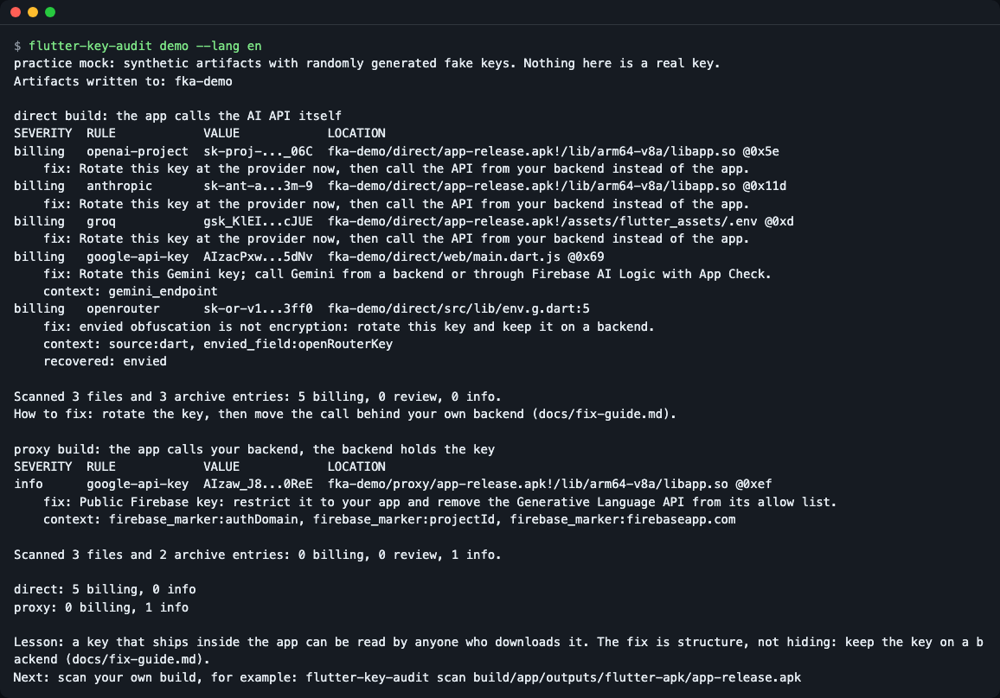
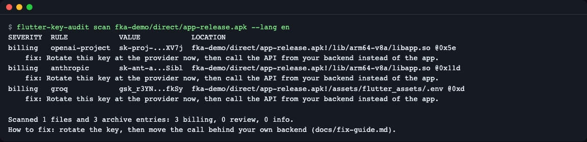
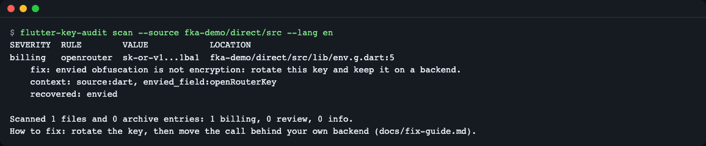
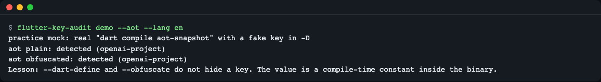
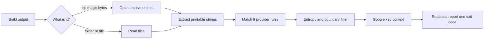

# flutter-key-audit

**English** | [한국어](README.ko.md)

Find billable AI provider API keys (OpenAI, Anthropic, Gemini, Groq and more) that a Flutter build ships to your users, then move the call behind a backend. It scans APK, AAB, IPA, macOS app, web build and source, offline, and never prints a key in full.


*`flutter-key-audit demo`: the same app built two ways. The direct build leaks 5 keys, the proxy build leaks none (practice mock with random fake keys).*

## Who this is for

- You call OpenAI, Anthropic or Gemini straight from a Flutter app and want to know what is inside the release build before you upload it.
- You run CI and want a build to fail when a billable key is found in `app-release.apk`, `build/web` or an `.ipa`.
- You used `--dart-define`, `--obfuscate` or envied and believe the key is hidden. It is not (see [How it works](#how-it-works)).

## Install

Requires the [Dart SDK](https://dart.dev/get-dart) 3.8 or newer (it comes with Flutter). On a minimal Linux image you also need `git` and `curl`.

```bash
git clone https://github.com/LeeGyeongPil/flutter-key-audit
cd flutter-key-audit
dart pub get
mkdir -p build
dart compile exe bin/flutter_key_audit.dart -o build/flutter-key-audit
build/flutter-key-audit --version
```

```text
flutter-key-audit 0.1.0
```

Put `build/flutter-key-audit` on your `PATH`, or call it by path. The examples below write `flutter-key-audit` for short.

## Quick start

Try the practice mock first. It needs no key, no network and no Flutter build. It writes fake artifacts with random fake keys in the same layout a real build has, then scans them.

```bash
flutter-key-audit demo --lang en --out fka-demo
```

The last lines of the output:

```text
direct: 5 billing, 0 info
proxy: 0 billing, 1 info

Lesson: a key that ships inside the app can be read by anyone who downloads it. The fix is structure, not hiding: keep the key on a backend (docs/fix-guide.md).
Next: scan your own build, for example: flutter-key-audit scan build/app/outputs/flutter-apk/app-release.apk
```

This is a **practice mock**: the files are synthetic, except `demo --aot`, which really compiles a Dart program. Key values are random on every run, so yours will differ from the screenshots. Scanning your own build (below) is the real mode and needs no network either.

Scan your own release build:

```bash
flutter build apk --release
flutter-key-audit scan build/app/outputs/flutter-apk/app-release.apk
```

## Usage

| Command / option | What it does | Example |
|---|---|---|
| `scan <path>...` | Scans APK, AAB, IPA, zip (found by magic bytes, not by extension), build folders and single files | `scan build/web` |
| `scan --source <dir>` | Source mode: reads text files, recovers envied keys, reports line numbers | `scan --source .` |
| `-f, --format table\|json\|sarif` | Report format | `--format sarif` |
| `-o, --output <file>` | Write the report to a file | `--output fka.sarif` |
| `--fail-on billing\|review\|info\|none` | Lowest severity that gives exit code 1 (default `billing`) | `--fail-on review` |
| `--min-entropy <n>` | Drop candidates below this Shannon entropy (default 3.0) | `--min-entropy 0` |
| `--max-entry-mb <n>` | Skip files and archive entries larger than this (default 512) | `--max-entry-mb 100` |
| `--exclude <text>` | Skip paths containing this text (repeatable) | `--exclude test/` |
| `rules` | Lists the 9 detection rules | `rules --lang en` |
| `demo [--aot] [--out dir]` | Practice mock; `--aot` also compiles a real Dart AOT snapshot | `demo --aot` |
| `--lang en\|ko` | Output language | `--lang ko` |

Where to look in each build output:

| Build | What the tool opens |
|---|---|
| `flutter build apk` / `appbundle` | `lib/<abi>/libapp.so`, `assets/flutter_assets/` (including `.env`) |
| `flutter build ipa` | `Frameworks/App.framework/App`, `flutter_assets/` |
| `flutter build macos` | the `.app` folder: `App.framework/App`, `flutter_assets/` |
| `flutter build web` | `main.dart.js` and assets in `build/web` |
| source | `.env`, Dart files, envied generated files (`--source`) |

I could not produce real `flutter build apk` or `macos` output inside my test sandbox. The tests use generated archives with the same layout, and `demo --aot` compiles a real Dart AOT snapshot (the format of `libapp.so`).

### 1. Scan an APK

```bash
flutter-key-audit scan fka-demo/direct/app-release.apk --lang en
```


*Each row: severity, rule, redacted value, and `archive!/entry @0xoffset`. The second line of a row says what to do.*

```text
SEVERITY  RULE            VALUE            LOCATION
billing   openai-project  sk-proj-...X_LN  fka-demo/direct/app-release.apk!/lib/arm64-v8a/libapp.so @0x5e
    fix: Rotate this key at the provider now, then call the API from your backend instead of the app.
billing   anthropic       sk-ant-a...EIPP  fka-demo/direct/app-release.apk!/lib/arm64-v8a/libapp.so @0x11d
    fix: Rotate this key at the provider now, then call the API from your backend instead of the app.
billing   groq            gsk_HcRH...d0sr  fka-demo/direct/app-release.apk!/assets/flutter_assets/.env @0xd
    fix: Rotate this key at the provider now, then call the API from your backend instead of the app.

Scanned 1 files and 3 archive entries: 3 billing, 0 review, 0 info.
How to fix: rotate the key, then move the call behind your own backend (docs/fix-guide.md).
```

The exit code is 1 here because billable keys were found. The value is shown as first 8 characters, `...`, last 4. There is no option to print a key in full.

### 2. Check the "fixed" build

```bash
flutter-key-audit scan fka-demo/proxy/app-release.apk --lang en
```

```text
SEVERITY  RULE            VALUE            LOCATION
info      google-api-key  AIzacWmy...WKVU  fka-demo/proxy/app-release.apk!/lib/arm64-v8a/libapp.so @0xef
    fix: Public Firebase key: restrict it to your app and remove the Generative Language API from its allow list.
    context: firebase_marker:authDomain, firebase_marker:projectId, firebase_marker:firebaseapp.com

Scanned 1 files and 2 archive entries: 0 billing, 0 review, 1 info.
```

Exit code 0. A Google `AIza...` key is ambiguous: Firebase keys are public by design, Gemini keys are not. The tool decides from the same file or entry:

| Severity | Meaning |
|---|---|
| `billing` | A key that can be billed: a provider rule matched, or an `AIza` key next to a `generativelanguage.googleapis.com` address |
| `review` | An `AIza` key with no hint. Open it in Google Cloud and check its restrictions |
| `info` | An `AIza` key next to Firebase markers. Public by design, but restrict it |

The `context:` line shows the evidence. It is a heuristic, so read it before you trust it.

### 3. Source mode and envied

```bash
flutter-key-audit scan --source fka-demo/direct/src --lang en
```


*envied obfuscation is not encryption: the tool rebuilds the key from the two arrays and reports the line.*

```text
SEVERITY  RULE        VALUE            LOCATION
billing   openrouter  sk-or-v1...e626  fka-demo/direct/src/lib/env.g.dart:5
    fix: envied obfuscation is not encryption: rotate this key and keep it on a backend.
    context: source:dart, envied_field:openRouterKey
    recovered: envied

Scanned 1 files and 0 archive entries: 1 billing, 0 review, 0 info.
How to fix: rotate the key, then move the call behind your own backend (docs/fix-guide.md).
```

By default source mode skips `build/`, `.dart_tool/`, `.git/`, `ios/Pods/` and `node_modules/`. Source mode prints the same `How to fix:` line as an APK scan.

### 4. `--obfuscate` does not hide a key

```bash
flutter-key-audit demo --aot --lang en --out fka-aot
```


*A real `dart compile aot-snapshot` with a fake key in `-D`: found in both builds.*

```text
practice mock: real "dart compile aot-snapshot" with a fake key in -D
aot plain: detected (openai-project)
aot obfuscated: detected (openai-project)
Lesson: --dart-define and --obfuscate do not hide a key. The value is a compile-time constant inside the binary.
```

`--aot` needs `dart` on your `PATH`. If it is missing, the command prints a localized error and exits with 3.

### 5. Reports and exit codes

```bash
flutter-key-audit scan fka-demo/direct/app-release.apk --format sarif --output fka.sarif --fail-on none --lang en
```

JSON (`--format json`) has `schema`, `tool`, `findings[]` (`rule`, `severity`, `confidence`, `redacted`, `location`, `context`, `fix`, `recovered`) and `summary`. SARIF is version 2.1.0. **JSON, SARIF, rule IDs and context codes are always in English and do not change with `--lang`.**

| Exit code | Meaning |
|---|---|
| 0 | Nothing at or above the `--fail-on` level |
| 1 | Found something at or above it |
| 2 | Usage error |
| 3 | Input or runtime error (for example `Path not found`) |

### 6. CI

```yaml
- run: flutter build web --release
- run: flutter-key-audit scan build/web --format sarif --output fka.sarif --fail-on billing
- uses: github/codeql-action/upload-sarif@v4
  if: always()
  with:
    sarif_file: fka.sarif
```

## Fix it

Finding a key is half the job. This is the short version of [docs/fix-guide.md](docs/fix-guide.md).

1. **Rotate the key first.** A key that was in a published build must be treated as stolen, even if the next release drops it. Create a new key, put it only on the backend, delete the old one, and check the provider's usage page for calls you do not recognise.
2. **Move the call behind your backend.** The app sends the user's login token to your server. Only the server holds the provider key.

   Before (the key ends up in the binary):

   ```dart
   const apiKey = String.fromEnvironment('OPENAI_API_KEY');
   final res = await http.post(
     Uri.parse('https://api.openai.com/v1/chat/completions'),
     headers: {'Authorization': 'Bearer $apiKey', 'Content-Type': 'application/json'},
     body: jsonEncode({'model': 'gpt-4o-mini', 'messages': messages}),
   );
   ```

   After (no provider key in the app; the backend picks the model and limits):

   ```dart
   final res = await http.post(
     Uri.parse('https://api.your-app.example/v1/chat'),
     headers: {
       'Authorization': 'Bearer ${await auth.currentUserIdToken()}',
       'Content-Type': 'application/json',
     },
     body: jsonEncode({'messages': messages}),
   );
   ```

   The backend checks the token, applies per-user limits and a spending cap, then forwards the request with the key from its own environment. A minimal `dart:io` sketch is in the guide (a sketch, not production code).
3. **Gemini: use Firebase AI Logic with App Check.** The app calls Gemini without a Gemini key inside it, and App Check rejects requests that do not come from your genuine app. Never put a Gemini Developer API key in `firebase_options.dart`. See the [Firebase AI Logic documentation](https://firebase.google.com/docs/ai-logic/app-check) (checked 2026-11-13).
4. **Restrict Firebase keys.** An `AIza...` key in `google-services.json` or `GoogleService-Info.plist` is public by design (an `info` finding). Restrict it to your Android package and SHA-1 or iOS bundle ID, and remove *Generative Language API* from its API restrictions so it cannot bill Gemini calls.
5. **Scan again.** Rebuild and run `flutter-key-audit scan` on the new build; exit code 0 means no billable key was found in that file.


## Settings

- **Language**: `--lang en|ko`, then `FLUTTER_KEY_AUDIT_LANG`, then `LC_ALL`, `LC_MESSAGES`, `LANG` (a value starting with `ko` gives Korean, anything else gives English).
- **Rules**: `flutter-key-audit rules` lists the 9 rules: `anthropic`, `openai-project`, `openai-legacy`, `openrouter`, `groq`, `huggingface`, `replicate`, `xai`, `google-api-key`. The key formats are the providers' current ones as of 2026-11-13 and can change.
- **Symlinks**: a symlinked file found while walking a folder is scanned once. Links to folders or missing targets are skipped and counted in the summary (`links_skipped` in JSON). Pass the real path to scan them.
- **Low entropy**: candidates below 3.0 bits per character (for example `xxxxxxxx`) are dropped and counted as `low_entropy_skipped` in the summary. Use `--min-entropy 0` to keep them.
- No API key, account or network access is needed.

## How it works



1. Zip files are opened by their first bytes (`PK\x03\x04`), so an APK renamed to `.bin` still opens.
2. Binaries are not parsed. The tool only takes runs of 8 or more printable bytes, like `strings -n 8`. Dart string constants sit as plain text in the AOT snapshot, which is enough.
3. Each run is matched against the provider rules. The key must start at a boundary; in source mode it must also end at one.
4. Low-entropy matches are dropped, so a fake `xxxx` key does not count.
5. `AIza` keys are classified by what else is in the same file or entry.
6. Findings are printed with the middle of the key hidden. The full value is only compared in memory and never written.

Why hiding does not work: `--dart-define` makes a compile-time constant stored as a plain string in `libapp.so`, `App.framework/App` or `main.dart.js`. `--obfuscate` only renames symbols. A `.env` listed as an asset is copied into `flutter_assets/`. envied stores two integer arrays that ship together and one XOR rebuilds the key. See [Flutter obfuscation](https://docs.flutter.dev/deployment/obfuscate) and [Dart environment declarations](https://dart.dev/libraries/core/environment-declarations) (checked 2026-11-13).

## When to use it

- Good fit: a Flutter app that talks to an AI provider, a pre-release check, a CI gate on the build output.
- It only scans files you give it. It cannot tell whether a key is still alive and does not call any provider.
- Secret scanners for source repositories, such as [gitleaks](https://github.com/gitleaks/gitleaks) and [trufflehog](https://github.com/trufflesecurity/trufflehog), cover many more secret types and remain the right choice for your git history.

Measured on the practice-mock artifacts (2026-11-13, macOS, default settings, no custom config). These tools are built for source repositories, so this shows what a default run reports on Flutter build output and is not a ranking:

| Input | flutter-key-audit 0.1.0 | gitleaks 8.30.1 | trufflehog 3.99.8 (`--no-verification`) |
|---|---|---|---|
| `direct/` folder (APK, web build, AOT binary; binary mode, no `--source`) | 5 billing | 1 finding (`gcp-api-key` in `main.dart.js`) | not run on this folder; on an APK with a `.env`, only the Groq key was found |
| real AOT ELF from `demo --aot` | detected | `no leaks found` | file not read (`chunks 0, bytes 0`) |

Reproduce with `tool/compare_scanners.sh` (needs the tools installed; it skips a missing one). Those tools can be configured to cover more; this table is the default behavior only.

## Roadmap

- **0.1.0 (this release)**: everything above.
- **Next**: a runnable `example/` proxy server and a before/after Flutter example app, custom rules (`--rules`), a baseline file for known findings, a GitHub Action wrapper.
- **Later**: nested archives, UTF-16 strings, more providers whose key format is documented, a check of `--dart-define-from-file`.

## Limitations

- envied keys are recovered only in source mode. Inside binaries the arrays are scattered snapshot objects.
- UTF-16 strings and zips inside zips are not scanned yet.
- The Google key context is a heuristic.
- It is for checking your own builds. It does not verify keys against any provider.
- Symlinks to folders and broken symlinks inside a scanned folder are not followed; the summary says how many were skipped.
- A clean result is not proof the app is safe.

## Troubleshooting

| Symptom | Cause | Fix |
|---|---|---|
| `Error: Path not found: ...` (exit 3) | Wrong path or no build yet | Run `flutter build ...` and check the path |
| No findings, summary shows `low_entropy_skipped` | Test keys such as `xxxx` are filtered | Use a realistic key, or `--min-entropy 0` |
| Exit 1 in CI but you only want a report | `--fail-on` default is `billing` | Add `--fail-on none` |
| `demo --aot` fails | `dart` is not on `PATH` | Install the Dart SDK or use plain `demo` |
| `dart pub get` fails with a certificate error | A proxy or sandbox blocks pub.dev | Run it where pub.dev is reachable |
| An `AIza` key is `review` | No Firebase or Gemini hint nearby | Check its API restrictions in Google Cloud |

## Development

```bash
dart pub get
dart test
dart analyze --fatal-infos
dart format --output=none --set-exit-if-changed .
```

All test fixtures are generated at run time with random fake keys; no real key or network is used. Bugs and ideas are welcome as issues. Changes are in [CHANGELOG.md](CHANGELOG.md).

## License

MIT. Dependencies: [archive](https://pub.dev/packages/archive) (MIT), [args](https://pub.dev/packages/args) (BSD-3-Clause).
